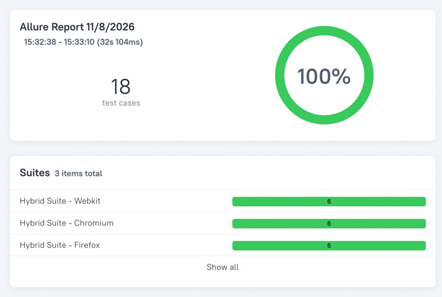
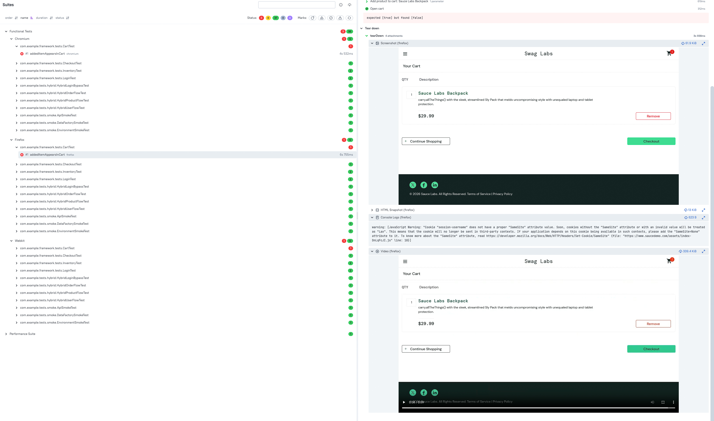
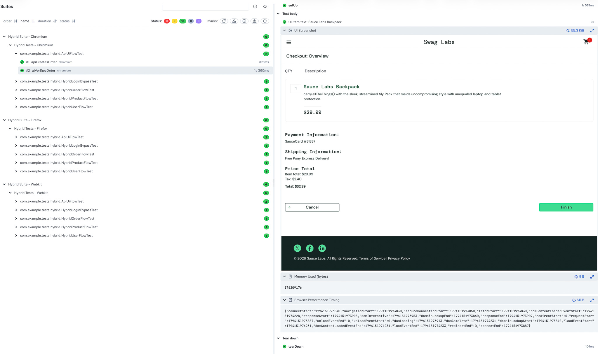
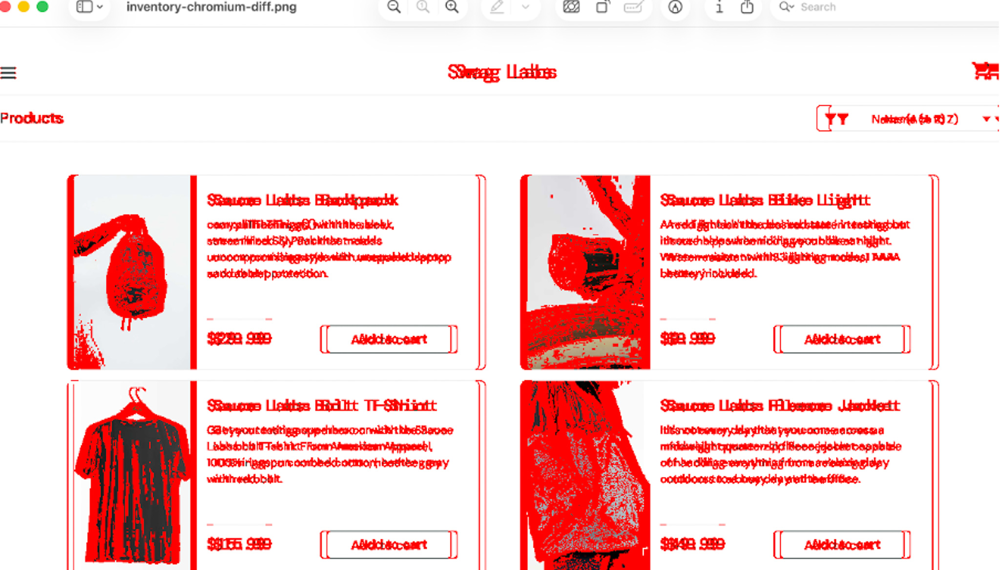

# Playwright TestNG Automation Framework

A Java-based automation framework built with Playwright and TestNG demonstrating:

* UI Automation
* API Testing
* Hybrid API + UI Testing
* Visual Regression Testing
* Performance Testing
* k6 Load Testing
* Docker Execution
* GitHub Actions CI/CD
* Cross-Browser Testing
* Allure Reporting

Supported browsers:

* Chromium
* Firefox
* WebKit

The framework demonstrates end-to-end automation, CI/CD integration, visual validation, performance monitoring and load 
testing using modern automation tooling.

## Table of Contents

* Technology Stack
* Functional Testing Suite
* Diagnostic Suite
* Hybrid Testing Suite
* Visual Regression Suite
* Load Testing Suite

### Technology Stack

* **Language**: Java 21
* **UI Automation**: Playwright
* **Test Framework**: TestNG
* **API Testing**: Playwright APIRequestContext
* **Reporting**: Allure
* **CI/CD**: GitHub Actions
* **Visual Testing**: Custom VisualAssert Utility
* **Performance Testing**: Playwright Performance API
* **Load Testing**: k6
* **Mock Services**: Node.js + json-server
* **Containerisation**: Docker

**Cross Browser Allure Overview**

Cross-browser execution results aggregated into a single Allure report for Chromium, Firefox and WebKit.





### Functional Testing Suite

#### Overview

The Functional Testing Suite validates the core functionality of the framework across Chromium, Firefox and WebKit.

The suite includes:

* UI tests covering key end-to-end user journeys on the SauceDemo application.
* Hybrid API + UI tests that combine backend setup with frontend validation.
* API smoke tests that validate core backend functionality.
* Performance testing executed as part of the GitHub Actions workflow.

A mock API and frontend environment is used for hybrid testing and selected API smoke scenarios. The SauceDemo 
application was chosen because it provides realistic e-commerce workflows that are well suited to UI and end-to-end 
automation testing.

For further details on the hybrid testing approach and the use of a mock environment, see the **Hybrid Suite** section.

#### Running the Functional Suite Locally

**Start the Mock API and Frontend**

Open a terminal and run:

1. `npm run mock-api`

Expected output:

1. Mock API + Frontend running on http://localhost:3001

**Execute Tests**

Open a second terminal and run one of the following:

Chromium

1. `mvn test -DsuiteXmlFile=testng.xml -Dbrowser=chromium`

Firefox

1. `mvn test -DsuiteXmlFile=testng.xml -Dbrowser=firefox`

WebKit

1. `mvn test -DsuiteXmlFile=testng.xml -Dbrowser=webkit`

**Generate the Allure Report**

1. `mvn allure:serve`

**Failure Diagnostics**

When a test fails, the framework automatically captures:

* Screenshot
* HTML Snapshot
* Console Logs
* Video Recording

For implementation details, see the **Diagnostic Suite** section.

#### GitHub Actions CI Workflow

The Functional Testing workflow executes approximately **40 tests** across multiple browsers and includes performance 
testing.

**Workflow Coverage**

* **UI Tests**: Chromium, Firefox, WebKit
* **Hybrid Tests**: Chromium, Firefox, WebKit
* **API Smoke Tests**: Chromium, Firefox, WebKit
* **Performance Test**: Chromium

**Workflow Structure**

The workflow consists of:

1. Chromium execution
2. Firefox execution
3. WebKit execution
4. Performance test execution
5. Combined Allure report generation

The workflow is triggered automatically on every push or pull request to the main branch.

**Downloading the Combined Allure Report**

The primary artifact generated by the workflow is:

1. allure-report-combined

After downloading and extracting the artifact:

1. Open a terminal.
2. Navigate to the extracted directory:
   `cd ~/Downloads/allure-report-combined`
3. Start a simple local web server:
   `python3 -m http.server 8000`
4. Open the report:
   http://localhost:8000

Note: Any available port can be used in place of 8000.

**Failure Diagnostics**

When a test fails, the framework automatically captures:

* Screenshot
* HTML Snapshot
* Console Logs
* Video Recording

For implementation details, see the **Diagnostic Suite** section.

**Performance Metrics**

The workflow includes a dedicated performance test that validates the Inventory page against predefined performance 
budgets.

Metrics collected include:

* Inventory UI readiness time (ms)
* DOM Content Loaded time (ms)
* Page Load Event time (ms)
* JavaScript Heap Usage (MB)

**Regenerating the Report Locally**

A downloaded Allure artifact can be regenerated locally by copying the contents into:

1. target/allure-results

and running:

1. `mvn allure:serve`

**Workflow File**

1. .github/workflows/testng.yml

#### Functional Suite Using Docker

##### Overview

The Functional Suite can be executed inside a containerised Docker environment both locally and through GitHub Actions.

Currently, Docker execution is configured to run against Chromium only.

##### Running the Functional Suite Using Docker Locally

**Prerequisites**

* Docker Desktop installed and running.

**Build the Docker Image**

From the project root directory:
1. `docker build --platform linux/amd64 -t playwright-tests .`

**Run the Container**
```bash
docker run --rm --platform linux/amd64 \
--env-file .env \
-p 3001:3001 \
-v $(pwd)/reports:/app/target/surefire-reports \
playwright-tests
```

**View the Generated Reports**

Navigate to the reports folder and open either report:

1. `open reports/index.html`

1. `open reports/emailable-report.html`

**Notes**

* Approximately 13 Chromium tests are executed.
* The Performance Test is not executed as part of the Docker run.
* Failure attachments are not currently included in the generated Docker reports.

##### Running the Functional Suite Using Docker in GitHub Actions

The **Playwright TestNG CI (Docker)** workflow executes automatically on pushes and pull requests to the main branch.

**Downloading Reports**

Download the following artifact:

1. surefire-reports

After extracting the artifact:

1. `open emailable-report.html`

1. `open index.html`

**Workflow File**

1. .github/workflows/docker-tests.yml

**Notes**

* Docker Desktop is not required when running through GitHub Actions.
* Failure attachments are not currently included in the Docker report output.

------------------------------------------------------------------------------------------------------------------------

### Diagnostic Suite

#### Overview

The Diagnostic Suite contains a dedicated test that intentionally fails in order to validate the framework's 
failure-handling and reporting capabilities.

The suite verifies:

* Screenshot capture
* HTML snapshot capture
* Video recording
* Console log collection
* Test teardown execution
* Allure attachment generation
* Failure reporting

This suite is primarily used to confirm that diagnostic artifacts are consistently generated and attached to Allure 
reports when a test fails.

#### Diagnostic Attachments

When a test failure occurs, the framework automatically captures the following diagnostic artifacts.

**Screenshot**

Captures the browser state at the point of failure.

Typical uses:

* Identifying UI defects
* Verifying page state
* Confirming element visibility issues
* Investigating locator failures

**HTML Snapshot**

Captures the complete HTML source of the page at the point of failure.

Typical uses:

* Inspecting DOM structure
* Investigating hidden elements
* Reviewing dynamic classes and attributes
* Analysing disabled or unavailable controls

Screenshots show what the user saw, while HTML snapshots help explain why the UI appeared that way.

**Video Recording**

Captures a recording of the test execution.

Typical uses:

* Investigating flaky tests
* Understanding timing issues
* Analysing animations and transitions
* Reviewing end-to-end user flows

**Console Logs**

Captures browser console output generated during test execution.

Typical uses:

* JavaScript error investigation
* Monitoring failed API requests
* Identifying frontend application issues
* Reviewing browser warnings

#### Running the Diagnostic Suite Locally

**Clean Previous Results**

Remove any existing test artifacts:

1. `rm -rf target`

**Execute the Suite**

Run the suite against one of the supported browsers:

Chromium

1. `mvn test -DsuiteXmlFile=testng-diagnostic.xml -Dbrowser=chromium`

Firefox

1. `mvn test -DsuiteXmlFile=testng-diagnostic.xml -Dbrowser=firefox`

WebKit

1. `mvn test -DsuiteXmlFile=testng-diagnostic.xml -Dbrowser=webkit`

**Generate the Allure Report**

1. `mvn allure:serve`

**Expected Result**

The diagnostic test is intentionally designed to fail.

The generated Allure report should contain:

* Screenshot attachment
* HTML snapshot attachment
* Console log attachment
* Video attachment

All attachments are displayed in the **Tear Down** section of the failed test.

**Viewing the HTML Snapshot**

The HTML snapshot can be opened directly using a text editor such as:

* Notepad
* Visual Studio Code
* IntelliJ IDEA

This allows inspection of the page DOM at the exact point of failure.

#### GitHub Actions Diagnostic Workflow

The Diagnostic Workflow is designed to validate failure reporting in CI.

**Workflow Characteristics**

* Triggered manually from GitHub Actions.
* Executes against Chromium.
* Intentionally fails.
* Generates diagnostic artifacts for investigation.

**Available Attachments**

The workflow produces:
* Screenshot
* HTML Snapshot
* Console Logs
* Video Recording

These artifacts can be viewed directly within the generated Allure report.

**Generating the Report Locally**

Downloaded Allure result files can be copied into:

1. target/allure-results

and viewed locally using:

1. `mvn allure:serve`

**Workflow File**

1. .github/workflows/diagnostic.yml


**Automatic failure diagnostics including screenshot, HTML snapshot, console logs and video recording.**




------------------------------------------------------------------------------------------------------------------------

### Hybrid Testing Suite

#### Overview

The Hybrid Testing Suite combines API interactions with UI verification using Playwright and TestNG.

The suite demonstrates how API calls can be used to create or prepare test data before validating the resulting 
behaviour through the user interface. This approach reduces UI execution time while maintaining end-to-end validation.

The suite currently contains six hybrid tests:

* ApiUiFlowTest (contains two tests)
* HybridLoginBypassTest
* HybridOrderFlowTest
* HybridProductFlowTest
* HybridUserFlowTest

A mock API and frontend environment are used because SauceDemo does not support several capabilities required for hybrid 
testing, including:

* API-driven creation of users, products and orders
* Token injection into localStorage
* Custom data setup required for hybrid scenarios

To support these flows, a mock environment was implemented.

#### Mock Environment Components

**Mock API**

* Data stored in db.json
* API endpoints served by server.js

**Mock Frontend**

Static frontend pages served from the public directory, including:

* index.html
* login.html
* products.html
* orders.html
* cart.html

**Hybrid Tests**

Hybrid tests combine:

1. API setup using custom API clients
2. Data injection using browser storage
3. UI navigation using Playwright
4. UI verification using assertions


#### Key Components

**Core Framework**

* BaseTest - shared Playwright and TestNG setup
* BaseApiClient - base API client implementation
* ResponseValidator - API response validation helpers
* JsonUtils - JSON parsing and object mapping utilities

**API Clients**

* AuthClient
* OrderClient
* ProductClient
* UserClient

**Hybrid Test Classes**

* ApiUiFlowTest
* HybridLoginBypassTest
* HybridOrderFlowTest
* HybridProductFlowTest
* HybridUserFlowTest

#### Running the Hybrid Suite Locally

**Start the Mock Environment**

Open a terminal and run:

1. `npm run mock-api`

Expected output:

1. Mock API + Frontend running on http://localhost:3001

This starts:

* Mock API endpoints on:

http://localhost:3001

* Mock frontend pages on:

http://localhost:3001

**Execute Tests**

Open a second terminal and run one of the following suites:

Chromium

1. `mvn test -DsuiteXmlFile=testng-chromium-hybrid.xml`

Firefox

1. `mvn test -DsuiteXmlFile=testng-firefox-hybrid.xml`

WebKit

1. `mvn test -DsuiteXmlFile=testng-webkit-hybrid.xml`

**Generate the Allure Report**

1. `mvn allure:serve`

#### Additional Hybrid Reporting

The ApiUiFlowTest demonstrates enhanced reporting capabilities and includes:

* API-created order ID
* UI screenshot
* JVM memory usage
* Browser performance timing data
* Performance timing JSON attachment

These artifacts are displayed directly within the Allure report.

#### Failure Diagnostics

When a hybrid test fails, the framework automatically captures:

* Screenshot
* HTML Snapshot
* Console Logs
* Video Recording

See the **Diagnostic Suite** section for implementation details.

#### GitHub Actions CI Workflow

The Hybrid Suite executes automatically on pushes and pull requests to the main branch.

**Workflow Coverage**

The workflow executes the hybrid test suite against:

* Chromium
* Firefox
* WebKit

**Primary Artifact**

The main artifact generated by the workflow is:

1. allure-report-combined

**Viewing the Combined Report**

After downloading and extracting the artifact:

1. Open a terminal.
2. Navigate to the extracted directory:
   `cd ~/Downloads/allure-report-combined`
3. Start a local web server:
   `python3 -m http.server 8000`
4. Open:
   http://localhost:8000

in your browser.

Any available port may be used instead of 8000.

**Additional Reporting**

The CI workflow also includes the enhanced reporting available in ApiUiFlowTest, including:

* API-created order ID
* UI screenshot
* JVM memory information
* Browser performance timing JSON

**Generate the Report Locally**

Downloaded Allure result files can be copied into:

1. target/allure-results

and viewed locally using:

1. `mvn allure:serve`

**Workflow File**

1. .github/workflows/hybrid-tests.yml

#### Hybrid Testing Flow

The hybrid tests follow the workflow below:

API creates test data
↓
Playwright injects data into browser storage
↓
UI navigates to mock frontend page
↓
Assertions verify expected behaviour

Examples include:

* Creating users via API and validating through the UI
* Creating products via API and validating through the UI
* Creating orders via API and validating through the UI
* Authenticating via API and bypassing the login screen

**Notes**

The Hybrid Suite is designed to demonstrate hybrid testing patterns and framework design concepts.

For traditional UI testing, the framework continues to use SauceDemo.

For API-driven UI validation and advanced testing scenarios, the Hybrid Suite uses the mock environment to provide 
complete control over test data and workflows.

**Hybrid API + UI test reporting including UI screenshots, memory metrics and browser performance timing data.**





------------------------------------------------------------------------------------------------------------------------

### Visual Regression Suite

#### Overview

The framework includes visual regression testing using Playwright and a custom VisualAssert utility.

Visual testing is used to compare a current browser screenshot against an approved baseline image to detect unexpected 
UI changes.

The suite performs visual validation of:
* Login Page
* Inventory Page

Testing is executed independently for:
* Chromium
* Firefox
* WebKit

Each browser maintains its own visual baselines to account for browser-specific rendering differences.

#### Baseline Structure

Visual baselines are stored separately for each browser:

src/test/resources/baseline/
├── chromium/
│   ├── login.png
│   └── inventory.png
├── firefox/
│   ├── login.png
│   └── inventory.png
└── webkit/
    ├── login.png
    └── inventory.png

This ensures visual comparisons are performed against the correct browser-specific reference images.

#### Running Visual Tests Locally

Execute the browser-specific visual suites:

Chromium

1. `mvn test -DsuiteXmlFile=testng-visual-chromium.xml`

Firefox

1. `mvn test -DsuiteXmlFile=testng-visual-firefox.xml`

WebKit

1. `mvn test -DsuiteXmlFile=testng-visual-webkit.xml`

Generate the Allure report:

1. `mvn allure:serve`

If the current screenshots match the approved baselines, all visual tests pass successfully.

#### Refreshing Baselines

To create or update baselines, run:

Chromium

1. `mvn test -DsuiteXmlFile=testng-visual-chromium.xml -Dbaseline=true`

Firefox

1. `mvn test -DsuiteXmlFile=testng-visual-firefox.xml -Dbaseline=true`

WebKit

1. `mvn test -DsuiteXmlFile=testng-visual-webkit.xml -Dbaseline=true`

When baseline mode is enabled, the existing baseline image is replaced with the newly generated screenshot.

#### Visual Regression Results

During a normal visual comparison run, the framework generates:

target/
├── login-<browser>-current.png
├── login-<browser>-diff.png
├── inventory-<browser>-current.png
└── inventory-<browser>-diff.png

**Current Image**

Represents the screenshot captured during the current test execution.

**Diff Image**

Highlights visual differences between the baseline and current image.

Differences are highlighted in red.

Diff images are generated even when no visual differences exist, providing a consistent comparison artifact.

#### Failure Diagnostics

When a visual test fails, the framework automatically captures:

* Screenshot
* HTML Snapshot
* Console Logs
* Video Recording

See the **Diagnostic Suite** section for implementation details.

#### GitHub Actions Workflow

Visual regression testing is executed automatically using the GitHub Actions workflow:

1. .github/workflows/visual-regression.yml

The workflow executes visual validation for:

* Chromium
* Firefox
* WebKit

**Available Artifacts**

The workflow uploads:

* Browser-specific Allure results
* Current screenshots
* Diff screenshots
* Browser-specific baseline images (when generated)

**Viewing Results**

Visual differences can be reviewed directly from the uploaded:

1. visual-regression-current-*

and

1. visual-regression-diffs-*

artifacts.

The diff images highlight any detected visual changes.

#### CI Baseline Management

Baselines can be generated directly in GitHub Actions using the workflow's manual trigger option.

Generated baseline artifacts can then be downloaded and copied into:

1. src/test/resources/baseline/<browser>/

After committing the updated baselines, subsequent workflow executions compare against the approved CI-generated 
reference images.

#### Expected Behaviour

The suite behaves as follows:

* Tests pass when the UI matches the approved baselines.
* Browser-specific baselines prevent cross-browser rendering differences from producing false failures.
* Current screenshots capture the latest rendered page.
* Diff screenshots highlight visual differences.
* Failure diagnostics and Allure reporting are generated automatically.

#### Baseline Management Policy

Baseline images act as the approved visual reference for regression testing and should be updated only when a UI change 
is expected and has been reviewed.

**When To Refresh Baselines**

Update baselines only after intentional UI changes, such as:

* Approved design changes
* New layouts
* Updated branding
* Expected visual enhancements

**Refresh Process**

1. Generate new baselines using the CI baseline-generation workflow.
2. Download the generated baseline artifacts.
3. Replace the corresponding images in:
   src/test/resources/baseline/<browser>/
4. Commit the updated baseline images:
   `git add src/test/resources/baseline/
   git commit -m "Refresh visual baselines after approved UI update"
   git push origin main`

**Review Requirement**

Baseline updates should be reviewed in pull requests to confirm that visual differences are intentional and expected.

**Golden Rule**

Never update a baseline solely to make a failing visual test pass.

Investigate the generated current and diff images first. Refresh the baseline only when the visual change has been 
reviewed and approved.


**Visual regression failure highlighting differences between the baseline and current screenshot.**





------------------------------------------------------------------------------------------------------------------------

### Load Testing Suite

#### Overview

The framework includes load testing capabilities using k6.

The suite is designed to validate application responsiveness and reliability under load, by executing multiple virtual 
users against mock frontend pages and API endpoints, hosted by a lightweight mock environment built with Node.js and 
json-server.

The following load scenarios are included:

* Home Page Load
* Login Load
* Browse Load
* Order Load

#### Metrics Collected

The load tests collect and aggregate the following metrics:

* Total Requests
* Total Errors
* Error Rate
* Average Latency
* P95 Latency

Results are displayed both in the GitHub Actions logs and within the generated summary artifact.

#### Why a Mock Environment?

The SauceDemo application requires authentication before accessing key application flows.

To isolate and independently load test specific user journeys such as browsing, login and ordering, the framework uses 
a lightweight mock environment built with Node.js and json-server to host dedicated API endpoints and frontend pages.

This provides:

* Consistent test execution
* Repeatable results
* Controlled test data
* Independent load testing of individual flows

#### GitHub Actions Load Testing Workflow

The load testing workflow can be triggered manually through GitHub Actions.

**Load Scenarios Executed**

The workflow executes four k6 scenarios:

* Home Page Load
* Login Load
* Browse Load
* Order Load

Each scenario generates an individual result file which is later aggregated into a single summary.

**Workflow Artifacts**

The primary artifact generated by the workflow is:

1. k6-summary

**Viewing Results**

Download the k6-summary artifact and open:

1. summary.json

using:

* Visual Studio Code
* IntelliJ IDEA
* Any JSON viewer

The summary contains aggregated results for all load scenarios.

Example metrics include:
* Requests
* Errors
* Error Rate
* Average Latency
* P95 Latency

alongside per-scenario statistics.

**Workflow Logs**

Load metrics are also displayed directly within GitHub Actions:

* Individual scenario execution logs
* Aggregated summary output

This allows quick review without downloading any artifacts.

**Workflow File**

1. .github/workflows/load-tests.yml

**Success Criteria**

The load tests validate that:

* Request failures remain within acceptable limits.
* Response times remain within configured thresholds.
* P95 latency budgets are met.
* All scenarios complete successfully under load.

Threshold validation is performed automatically by k6 during execution.

